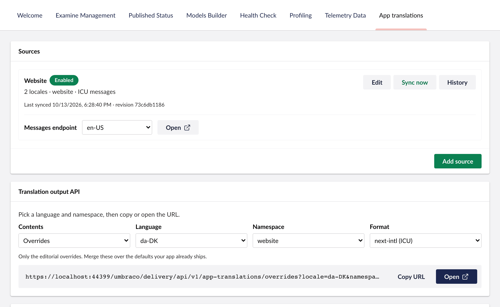

## 1. Install the package

```sh
dotnet add package TheBuilder.AppTranslations
```

Start the site. On the first start, the package creates its tables and opens its **App Translations** section to the user groups that can open Umbraco's Translation section, Administrators and Translators on a new site.

## 2. Make your translation files reachable

Umbraco reads your application's translation files over HTTP, one file per language. Serve them from your application, a CDN or any URL your Umbraco site can reach. A next-intl application's `messages/en-US.json` might look like this:

```json messages/en-US.json
{
  "navigation": { "home": "Home", "contact": "Contact" },
  "greeting": "Welcome, {name}!"
}
```

## 3. Add a source

In Umbraco, go to **Settings > App translations** and add a source. A source holds the URL of the files, the languages to read, and the message syntax your application uses.



For the file above, served at `https://app.example.com/messages/en-US.json` and `.../da-DK.json`:

| Setting | Value |
| --- | --- |
| Messages endpoint | `https://app.example.com/messages/{locale}.json` |
| Site languages | English (United States) and Danish |
| Catalogue format | Nested JSON |
| Namespace handling | Use one namespace for every message, named `website` |
| Message syntax | ICU messages |

The messages arrive as `website.navigation.home`, `website.greeting` and so on.

- **Test source** fetches the files without saving anything.
- **Sync now** reads them in.

See [Sources](/sources) for the URL placeholders, namespaces and every setting.

## 4. Edit a message

Open the **App Translations** section, find a message, and write custom text for it. **Save** makes it live.

## 5. Use it in your application

Point your application at the delivery endpoint for a language and namespace, and merge the custom text over the messages it bundles:

```http
GET /umbraco/delivery/api/v1/app-translations/overrides?locale=da-DK&namespace=website&format=next-intl
```

The locale is Umbraco's code, `da-DK`, even if your application calls it `da`. [Delivery API](/delivery-api) has a complete next-intl and i18next example, and covers caching and keys.
