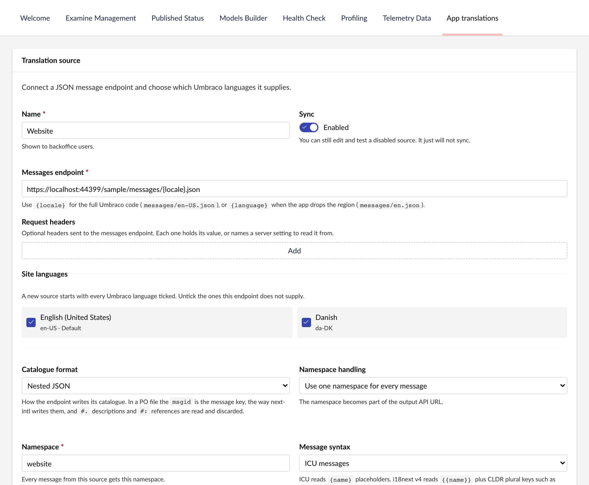

A source is one set of translation files. Add and manage sources in **Settings > App translations**.

## The URL

A placeholder in the source's URL names the language to fetch:

```text
https://app.example.com/messages/{locale}.json     ->  .../messages/en-US.json
https://app.example.com/messages/{language}.json   ->  .../messages/en.json
https://app.example.com/{language}/{locale}.json   ->  .../en/en-US.json
```

Umbraco's language codes carry a region, such as `en-US`, but many applications name their files by language alone, such as `en`. Use `{language}` when yours do. Umbraco still stores each message under the full code, so `en-US` and `en-GB` stay separate.

## Settings



- **Message syntax.** ICU messages, as next-intl and FormatJS use them, i18next JSON v4, or plain text. The editor checks every change against the syntax, so an edit cannot break a placeholder or a plural.
- **Namespace handling.** Use the first key of the JSON as the namespace, or put every message in one namespace you name. See [Namespaces](#namespaces).
- **Advanced.** The source identifier for [deployment-triggered sync](/syncing#syncing-from-a-deployment), a request timeout (10 seconds by default), and the largest response the source accepts (10 MB by default).

**Test source** fetches the files with the current settings without saving anything. **Sync now** reads them in.

## Namespaces

A namespace is the group your application fetches together: the delivery endpoints serve one namespace for one language per request. Every message belongs to exactly one, and Umbraco shows keys as `namespace.key`.

Take a file with two top-level keys:

```json
{
  "navigation": { "home": "Home" },
  "checkout": { "pay": "Pay now" }
}
```

| Namespace handling | Namespaces | Keys |
| --- | --- | --- |
| **One namespace for every message**, named `website` | `website` | `navigation.home`, `checkout.pay` |
| **First key of the JSON** | `navigation` and `checkout` | `home`, `pay` |

Use one namespace when your application loads the whole file at once, as a next-intl application with a single `messages/{locale}.json` does. Use the first key when the top-level keys are separate bundles your application loads on their own, such as i18next namespaces.

The response for a namespace leaves the namespace out. Asking for `website` returns `{"navigation": {"home": ...}, "checkout": {...}}`, the same shape as the file. Asking for `navigation` returns `{"home": ...}`, so put it back under `navigation` before merging.

Two sources can share a namespace, as long as they do not supply the same key.

## Sources that need authentication

You can add request headers to a source. Each header either holds its value, or names a configuration setting that supplies the value when Umbraco makes the request.

:::caution
A value typed into a header is stored in the database in plain text. Put secrets in a setting.
:::

This example gives a header `X-Api-Key` the setting name `Translations:SourceApiKey`:

```json
{
  "Translations": {
    "SourceApiKey": "development-value-only"
  }
}
```

In a deployed environment, supply the value as the environment variable `Translations__SourceApiKey` or through your secret store. For a bearer token, add an `Authorization` header and make the setting's value the whole header, for example `Bearer your-token`.

## Sources on a private network

By default, sources connect only to public addresses, do not follow redirects and do not use the host's proxy. That stops anyone from using a source URL to reach internal services.

To read from a private network or `localhost`, turn on `TheBuilder:AppTranslations:SourceSecurity:AllowPrivateNetworkEndpoints`.

:::caution
Only allow private-network sources in development or a network you trust.
:::
